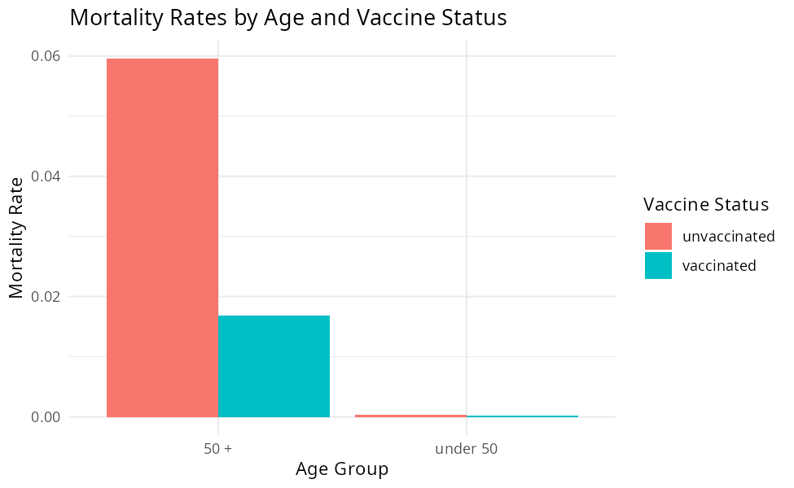

# Introduction
This repository holds my STAT 184 COVID-19 vaccine mortality analysis. The dataset tracks 268,166 individual COVID-19 cases with each person's age group, vaccination status, and survival outcome, and the goal is to see whether vaccination lowers mortality once age is taken into account.

# Implementation
I converted the original R script into a Quarto document (`code/covid_vaccine_study.qmd`) using `dplyr`, `ggplot2`, `knitr`, and `kableExtra`. At first, combining everyone together makes vaccinated mortality look higher, so I stratified the summary tables and grouped bar charts by `age_group` (`50 +` vs. `under 50`) to separate age risk from vaccine status.

# Results
After stratifying by age group, unvaccinated cases show a higher mortality rate than vaccinated cases in both age brackets (5.96% vs. 1.68% for ages 50+, and 0.033% vs. 0.023% for under 50).

